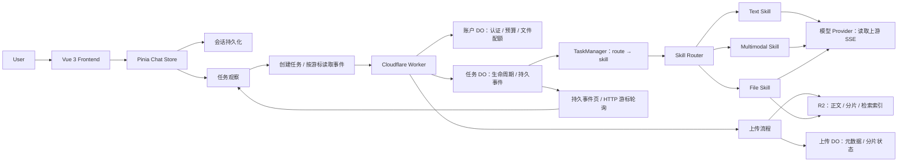

# AI Tool Chat

一个面向作品集和真实工程场景的 AI 对话平台：前端是 Vue 3 单页聊天工作台，后端是 Cloudflare Worker 编排层，支持流式对话、图片理解、文件上传、断点续传，以及普通文本文件的检索优先分析。

## Node.js 服务器版本

已新增普通 Node.js 后端入口 `packages/server`，复用业务逻辑，使用 SQLite
和私有本地文件替代 Cloudflare 存储服务。构建、配置和美国服务器部署说明见
[Node 后端指南](./packages/server/README.md)。Node 服务已部署到美国服务器
`154.37.208.170`，2026-10-02 已完成
[chat.i-tool-chat.store](https://chat.i-tool-chat.store/) 的 DNS 和 HTTPS 发布。
现已开放免登录访客入口，无需用户名和密码，每个浏览器的数据独立隔离。
公网访客会话、上传/删除及桌面/手机工作台验收通过，但模型密钥尚未配置，
真实 AI 对话仍不可用。旧 Cloudflare 入口和数据未修改，也未自动迁移。

## 代码阅读入口

先阅读 [整个平台：代码阅读与面试指南](./docs/guides/platform-reading-guide.md)，
再阅读 [任务执行链路](./docs/guides/task-execution-reading-guide.md)。
先掌握主流程和职责，再深入异步生成器、存储和失败边界。
2026-09-30 的本地执行链重构采用 `route -> skill`，保留旧任务类型兼容；
本地改动不代表下面的线上 Demo 已经更新。

## Demo / 素材

- 在线地址：[https://i-tool-chat.store](https://i-tool-chat.store)
- API 地址：[https://api.i-tool-chat.store](https://api.i-tool-chat.store)
- 演示素材目录：[`docs/assets/`](./docs/assets/)

当前仓库已经预留素材目录，你可以把录屏/GIF/截图放到这里后直接补到本 README：

- `docs/assets/chat-overview.png`
- `docs/assets/streaming-demo.gif`
- `docs/assets/file-upload-demo.gif`
- `docs/assets/architecture.png`

## 这不是普通聊天 Demo 的原因

这个项目不是“前端页面 + 一个模型 API”的简单套壳，而是做了完整的产品主链路和工程约束：

- `Task -> Step -> Skill` 职责分离：新任务记录路由与执行两个真实步骤
- 统一事件包含内容、进度、来源、用量和错误；当前本地持久任务按游标轮询，上游模型仍通过 SSE 流式读取
- 文件上传走分片上传、断点续传、Durable Object 状态恢复、R2 正文存储
- 普通文本文件默认走“检索优先”，限制进入模型的原文上下文，保留可核对的引用
- 前端 Store 是兼容入口，会话持久化与任务观察按功能分离
- 账户、任务额度与上传配额分离；恢复已有任务不会再创建模型请求

## 核心亮点

### 1. 任务流可视化

后端不是只返回最终文本，而是把一次请求拆成多个步骤，让前端能直接展示 AI 当前在做什么：

- `task`
- `step`
- `content`
- `sources`
- `usage`
- `error`
- `complete`

### 2. 大文件上传与断点续传

- 文件上传使用稳定 `fileId`
- 上传前查询服务端已收分片，只补传缺失部分
- Durable Object 只保存元数据和分片状态
- 合并后的正文写入 R2，避免大文本触发 DO 单值存储上限

### 3. 普通文本文件检索优先

普通文本文件不再默认全文丢进模型，而是：

1. 服务端读取文件正文
2. 切成稳定文本块
3. 根据问题做相关性打分
4. 只取少量高相关片段进入模型
5. 概览型问题使用代表性原文片段；检索不足时明确提示依据不足，不自动转为全文摘要

这个策略限制进入模型的文本规模。回答质量和端到端延迟需要独立评测，不能仅凭输入缩短宣称提升。

### 4. 前后端工程闭环

- 前端：`lint + build + vitest`
- Worker：`vitest + wrangler deploy --dry-run`
- 根目录统一命令：`pnpm check`
- GitHub Actions 已加入 `verify` 工作流，用于 PR / push 验证

## 架构概览



## 目录结构

```text
ai-tool-chat/
├─ packages/
│  ├─ frontend/   # Vue 3 + TypeScript + Pinia + Vite
│  └─ worker/     # Worker + 持久任务 / 账户 / 上传 / 上游 SSE
├─ docs/
│  ├─ adr/
│  ├─ assets/
│  ├─ plans/
│  └─ reference/
├─ AGENTS.md
└─ README.md
```

## 关键技术问题与解法

### 1. 如何避免聊天主链路状态分散

做法：

- 页面通过 `ChatStore` 的薄入口发起聊天
- `features/chat` 管理会话与消息，`features/tasks` 管理观察与事件协议
- 异步更新使用稳定消息 ID，删除或切换会话不会让旧响应写错位置
- 账户失效使用代次校验，读取响应体后再次检查，阻止旧响应恢复上一个账户

### 2. 如何让大文件上传可恢复

做法：

- 前端按分片上传
- 上传前先查 `/upload/status`
- 前端只补传缺失分片
- Worker 在合并前会校正 metadata，修复缺片状态

### 3. 如何避免 Durable Object 存大文本失败

做法：

- DO 只存上传状态和完成标记
- 文件正文写入 R2
- 文件分析阶段按 `fileId` 从 R2 读取正文

### 4. 如何压低普通文本文件分析 token

做法：

- 默认检索优先，不默认全文摘要
- 设置相关片段数量和上下文预算
- 连续提问命中同一文件的检索索引缓存

## 技术栈

### Frontend

- Vue 3
- TypeScript
- Pinia
- Vue Router
- Vite
- Markdown-It
- Vitest

### Worker

- Cloudflare Workers
- Wrangler
- SSE
- Durable Objects
- R2
- Vitest

## 本地运行

### 1. 安装依赖

```bash
pnpm install
```

### 2. 配置 Worker 环境变量

先用本地模拟模型验证流程，无需密钥。以下在两个终端中分别运行：

```powershell
pnpm --filter @ai-tool-chat/worker exec wrangler dev --local --ip 127.0.0.1 --port 8787 --var ENVIRONMENT:development --var MOCK_MODEL:true --var ALLOW_REGISTRATION:true --var ALLOWED_ORIGINS:http://127.0.0.1:5173
```

```powershell
$env:VITE_API_URL = 'http://127.0.0.1:8787'
pnpm --filter @ai-tool-chat/frontend dev --host 127.0.0.1 --port 5173 --strictPort
```

### 3. 接入真实模型

参考 [`packages/worker/.dev.vars.example`](./packages/worker/.dev.vars.example)。
当前 provider 使用百炼兼容接口和 `QWEN_API_KEY`；配置文本、图片、文件模型时，
须确认账号已开通对应能力。关闭 `MOCK_MODEL` 后会产生真实 API 消耗。
本地跨域地址须与 `ALLOWED_ORIGINS` 一致；生产注册默认关闭，不要把测试配置部署上线。

默认地址：

- Frontend: [http://localhost:5173](http://localhost:5173)
- Worker: [http://127.0.0.1:8787](http://127.0.0.1:8787)

## 工程验证

### 根目录统一检查

```bash
pnpm check
```

### 分包命令

前端：

```bash
pnpm --filter @ai-tool-chat/frontend lint
pnpm --filter @ai-tool-chat/frontend build
pnpm --filter @ai-tool-chat/frontend test
```

Worker：

```bash
pnpm --filter @ai-tool-chat/worker test
pnpm --filter @ai-tool-chat/worker exec wrangler deploy --dry-run
```

## 排障入口

先看 Worker 结构化日志里的这些字段：

- `route`
- `requestType`
- `taskId`
- `fileId`
- `skill`
- `model`
- `durationMs`
- `errorCode`

详细排障手册：

- [`docs/reference/ERROR_LOG.md`](./docs/reference/ERROR_LOG.md)

## 当前边界

### 工具调用

`enableTools` 目前仍是实验能力标记，仓库内已经预留 MCP 结构，但产品主链路仍然以聊天与文件分析为主。

### Task 生命周期

当前任务按账户保存于 Durable Object，可以查询快照和按序号回放事件；
刷新页面恢复的是查看，不是再次执行。执行实例中断后，已认领的任务明确失败，
保留已经提交的部分结果，不自动重发可能收费的模型调用。

不承诺任意步骤的检查点续算、长期无人值守任务、生产高并发与实际账单核对。
本地 DO 重建测试不等于完成 Cloudflare 生产故障演练。

详细说明：

- [`docs/adr/2026-09-30-platform-modules.md`](./docs/adr/2026-09-30-platform-modules.md)
- 早期 ADR 仅记录当时的边界，不代表当前实现。

## 简历 / 面试可直接使用的亮点文案

### 30 秒版本

- 基于 Vue 3 和 Cloudflare Worker 开发 AI 对话平台，支持文本、图片和文件输入。
- 将会话、任务、账户、上传与检索分离，使用持久任务和游标事件恢复查看，避免重复执行。
- 文件问答采用有预算的原文检索与引用展示；模型读取上游 SSE，浏览器读取持久事件页。

### 适合写在简历里的 3 条

1. 设计 Task / Step / Skill 职责边界，使用 Durable Object 持久化任务快照与有序事件，支持幂等创建、回放和取消；浏览器按游标恢复查看。
2. 实现分片上传、断点续传与 R2 正文存储，校验分片布局、账户归属及完成状态；通过失败注入验证丢失确认响应后的补传。
3. 构建检索优先的文件问答链路，限制原文上下文预算，保存来源、文件版本及文本位置，支持在回答中核对引用。

上述文案需在你能解释实现后再使用。没有真实模型数据，不写“延迟下降 X%”
或“token 成本下降 X%”。本轮是业务层重写，复用了已有解析、哈希、Markdown
和检索算法，没有宣称每行代码从零编写。

## 相关文档

- [`AGENTS.md`](./AGENTS.md)
- [`docs/api-reference.md`](./docs/api-reference.md)
- [`docs/openapi.yaml`](./docs/openapi.yaml)
- [`docs/frontend-learning-guide.md`](./docs/frontend-learning-guide.md)
- [`docs/reference/ERROR_LOG.md`](./docs/reference/ERROR_LOG.md)
- [`docs/plans/2026-03-29-task-pipeline-unification.md`](./docs/plans/2026-03-29-task-pipeline-unification.md)

## License

MIT
